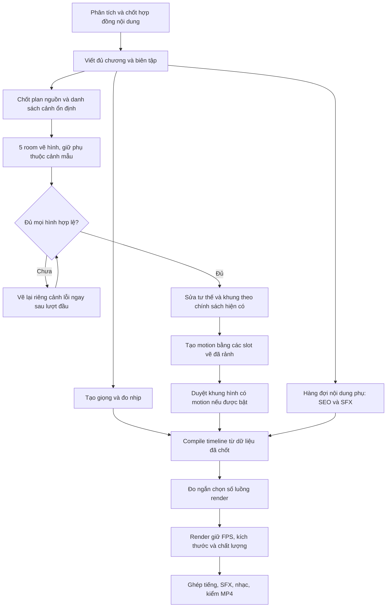

# Phân tích video mới nhất và cấu trúc quy trình để giảm thời gian chờ

Ngày kiểm tra: 06/11/2026, giờ Việt Nam. Tài liệu này là kết quả phân tích và thiết kế điều phối; chưa thay thêm code chức năng trong lượt phân tích này.

## 1. Đúng video và dữ liệu được kiểm tra

- Production: `f82fe2c76c1ab22004a52e6147acdf2c`.
- Tên: **Battle of the Granicus 334 BC: The Deciding Moment**.
- MP4 cuối: `storage/output/motion-video/battle-of-the-granicus-334-bc-the-deciding-momen-16x9-standard-1793914478395.mp4`.
- Kết quả: 671,6 giây, 1920×1080, 30 fps, 20.148 frame, 98 cảnh, khoảng 386 MiB. Hình và tiếng có trong MP4; job xuất hoàn tất.
- Đầu vào giữ Flash/medium cho hình, Flash/low cho nội dung và motion; tắt AI duyệt ảnh, bật SFX, motion/camera/effect nhẹ.
- Đã đọc production, các job con của cùng production, log có timestamp/sequence, diagnostic gửi/nhận, prompt measurements và spec đã xuất; trích frame từ MP4 thật. Không lấy kết quả kiểm chứng scratch của đợt trước làm video người dùng vừa chạy.

Dữ liệu phân tích local tại `scratch/motion-audit-20261106/`: overview, details, transport-details, visual-scenes, rig-missing, profile và benchmark Chrome. Chưa ghi đè dữ liệu dự án.

## 2. Thời gian thực tế và phần không được cộng nhầm

Từ 21:00:28 ngày 05/11 tới 04:37:36 ngày 06/11 là **7 giờ 37 phút 08 giây theo đồng hồ**. Đây gồm các lượt lỗi/tiếp tục, khoảng không có hoạt động được ghi và backend bị ngắt; không đồng nghĩa 7 giờ 37 phút CPU chạy liên tục.

| Phần | Mốc thực tế | Thời gian / kết quả |
| --- | --- | --- |
| Phân tích | 21:00:30–21:03:42 | Khoảng 3 phút 12 giây, đạt; có sửa ACK/Retry |
| Kịch bản lượt đầu | 21:03:43–21:18:12 | 14 phút 29 giây; thiếu chương 2, chưa được đi tiếp |
| Khoảng giữa hai lượt kịch bản | 21:18:12–21:34:30 | Khoảng 16 phút 18 giây; không quy hết thành thời gian AI xử lý |
| Viết tiếp + biên tập | 21:34:30–21:41:58 | 7 phút 28 giây; đủ chương, còn cảnh báo biên tập |
| Giọng | 21:41:58–22:00:36 | 18 phút 38 giây, chạy chồng với hình/SEO |
| SEO | 21:41:58–22:19:40 | 37 phút 42 giây, nhiều recovery; chạy chồng với hình/giọng, không cộng nguyên thời gian này vào đường hoàn tất |
| Hình lượt đầu | 21:41:58–22:52:40 | Khoảng 70 phút 42 giây; có 91 hình nhưng một nhóm phân cảnh chưa hoàn tất, job báo lỗi refusal |
| Tiếp tục hình | 22:54:28, có hoạt động tới 23:10:46 | Đủ 98 hình lúc 23:05:13, đang sửa tư thế/khung thì sau đó backend được ghi nhận bị ngắt |
| Khoảng không có log mới trước khôi phục | 23:10:46–01:11:11 | Xấp xỉ 2 giờ; không có dữ liệu đủ để nói toàn bộ khoảng này là tool đang tính toán |
| Lượt tiếp tục hoàn tất | 01:11:58–02:40:16 | **88 phút 18 giây**, chi tiết bên dưới |
| Compile / chuyển sang xuất | 02:40:16–02:40:40 | Khoảng 24 giây |
| Xuất và kiểm MP4 | 02:40:40–04:37:33 | **116 phút 53 giây** |

Các bước của lượt tiếp tục cuối:

| Phần | Mốc | Thời gian |
| --- | --- | --- |
| Nhận lại hình/cảnh cần xử lý từ checkpoint | 01:11:58–01:16:34 | 4 phút 36 giây; không phải vẽ mới toàn bộ 98 cảnh |
| Sửa tư thế/khung | 01:16:34–01:20:15 | 3 phút 41 giây, 4 cảnh |
| AI chuyển động | 01:20:15–02:29:43 | **69 phút 28 giây**, 98 tác vụ scene, 105 request qua chat tính cả sửa dữ liệu |
| AI SFX | 02:29:43–02:40:16 | **10 phút 33 giây**, 9 nhóm, chạy lần lượt |

Xuất MP4 gồm **6.767,1 giây dựng frame**, tương đương 112 phút 47 giây, rồi khoảng 3 phút 54 giây kiểm video/chuẩn hóa/ghép/kiểm âm thanh. Vì vậy bật GPU encoder hay đổi đoạn ghép tiếng không tự giải quyết phần lớn thời gian xuất.

## 3. Các lỗi và giới hạn đã xác định

### 3.1. Hoàn tất kỹ thuật không đồng nghĩa mọi cảnh hết cảnh báo chất lượng

- Log cuối ghi 98/98 có hình, **94 cảnh qua kiểm tra và 4 cảnh còn lưu ý**. AI duyệt ảnh đang tắt theo cấu hình; không tự bật trong thiết kế tối ưu.
- Cảnh 21, khoảng **02:18–02:24**: cảnh báo cắt đầu/tay Alexander. Frame MP4 ở 02:21 xác nhận người/ngựa lệch lên cao, đầu ra khỏi khung.
- Cảnh 45, khoảng **05:04–05:12**: phần đầu/mũ Spithridates rộng quá so với khuôn mặt.
- Cảnh 60, khoảng **06:46–06:54**: hai nhóm kỵ binh mỗi nhóm chỉ có 2 người trong khi brief yêu cầu 3.
- Cảnh 67, khoảng **07:39–07:46**: nhóm truy đuổi chỉ có 2 người so với yêu cầu 3.
- Các note này đã chạm giới hạn qualityRedraws=3 và code giữ hình hiện có. Đây là hành vi hiện có cần được báo rõ, không thể gọi toàn bộ 98 cảnh đều đạt chất lượng.
- Cảnh 6, khoảng **00:40–00:47**, không có kết quả AI-directed motion, vẫn có một animation dự phòng. Phân biệt lỗi motion AI với lỗi hình; không kết luận cảnh hoàn toàn không chuyển động.

Ảnh local:

- [Tổng quan các frame video](D:/video-AI-vidify/scratch/motion-audit-20261106/video-overview.jpg).
- [Mẫu cảnh cần xem](D:/video-AI-vidify/scratch/motion-audit-20261106/issue-samples.jpg), theo thứ tự 00:43, 01:52, 02:21, 05:08, 06:50, 07:42.

### 3.2. Thiếu đích chuyển động do chọn rig theo 64 nhóm đầu SVG

`motionClipPartIds()` lọc nhóm `<g>` rồi `.slice(0, 64)` theo thứ tự trong SVG. **38/98 rig đang có đúng 64 parts**.

Đã đối chiếu trực tiếp các ID lỗi với SVG/spec cuối:

- `water_granicus`, `effect_arrow_blizzard`, `effect_river_eddies`, `memnon_watching_retreat`: có nhóm `<g>` thật trong hình tương ứng nhưng không có trong rig đang bị giới hạn 64.
- `label_rejected_strategy` bị loại theo quy tắc bỏ nhóm label; AI vẫn được thấy dữ liệu layer/node và đã chọn nó làm đích.
- Còn có lỗi điểm neo emit và số phase không bằng số phần tử trong group.

Không phải mọi trường hợp đều do AI bịa ID. Đầu vào motion đang có thể mô tả chủ thể tồn tại nhưng không cung cấp nó trong danh sách đích được phép. Chỉ retry không sửa đầu vào sẽ lặp lại cùng nhóm lỗi.

### 3.3. Generic refusal còn biến thể chưa được recovery nhận

Lúc 01:22:30 có phản hồi thật: “Tôi chỉ là một công nghệ trí tuệ nhân tạo dựa trên văn bản, nên không thể trợ giúp về điều đó.” Regex generic recovery hiện chỉ nhận một số biến thể “mô hình ngôn ngữ”/language model, không khớp câu này.

Một số refusal ở lượt hình trước có biến thể “Tôi không được lập trình để làm điều đó.” Cần phân loại dựa trên phản hồi thực, artifact và trạng thái UI; giữ quota/CAPTCHA và refusal nội dung riêng. Không mở rộng thành mọi refusal đều retry mù.

### 3.4. Trạng thái thử motion có thể chặn tiếp tục

`directSceneMotion()` đánh dấu `motionTried[scene.id]` trước khi chờ kết quả; lỗi có thể giữ hình/motion dự phòng. Lần tiếp tục có thể xem attempted như đã xử lý và không gọi lại cùng key. Cần phân biệt rõ attempted, accepted và failed/retryable để tiếp tục đúng phần thiếu, giữ motion đã hợp lệ.

### 3.5. Trạng thái cảnh và nhóm phân cảnh đang dễ gây hiểu nhầm

Lượt đầu có 91 accepted trong snapshot nhưng nhóm phân cảnh vẫn lỗi; sau khi nhóm được xử lý thành công tổng tăng thành 98. Vì vậy số hình đang thấy không chứng minh plan nguồn đã đầy đủ. Log “không còn cảnh lỗi” chỉ nhìn danh sách hình có thể che phần nhóm còn lỗi. Khi khôi phục, snapshot/job cũng không thể dùng thay cho log lịch sử để kết luận đã có đủ cảnh ở mọi thời điểm trước đó.

Backend restart có bằng chứng trong job khôi phục, nhưng chưa có bằng chứng xác định nguyên nhân crash/restart là hết RAM hay lỗi code cụ thể. Không suy đoán nguyên nhân thành kết luận.

## 4. Vì sao chuyển động chậm

Trong lượt cuối:

- Pool hình có hoạt động song song tối đa 5. Pool motion chỉ chạy tối đa **2 request**, dùng `motion-primary` và `motion-second`; 5 tab vẽ không tự chuyển thành 5 worker motion.
- 105 request motion gồm 98 tác vụ cảnh và 7 lần sửa dữ liệu; không đồng nghĩa 105 tin nhắn thực được gửi trên Gemini.
- **57 request gửi trực tiếp:** trung bình 34,46 giây/request.
- **48 request phải chia ngữ cảnh:** trung bình 128,33 giây/request; mỗi request có 2 phần context rồi task cuối.
- Ghi nhận 99 lần xác nhận submit context, 96 phản hồi context hoàn tất và 3 lần sửa ACK; đây là overhead riêng ngoài 105 task cuối, không được cộng nhầm như 99 cảnh mới.
- `motionBible` cuối có **98 mục, khoảng 13.297 ký tự**. Quy tắc giới hạn bible 40 chỉ áp cho từng phản hồi, còn state tích lũy vẫn tăng. Đầu lượt prompt khoảng 7,5–11,4k; cuối lượt nhiều prompt khoảng 17,7–24k và phải chia phần.
- Log prompt measurements cho thấy `contextChars=0`: phần nặng nằm trong payload motion chứa bible, không phải vì toàn bộ editorial context được lặp thêm ở mọi request. Cần tối ưu đúng nguồn phình.

Thời gian từ request-start tới submit task cuối có thể bao gồm gửi/chờ ACK của context. Không gọi toàn bộ 137–191 giây ở các request chậm là “ô nhập bị treo”. Cần tách queue, model/UI, nhập, ACK, tạo nội dung và lưu trong timeline.

## 5. Đo render bằng Chrome thật

Giữ full spec 98 cảnh, 1920×1080/30fps, cùng 60 frame **240–299**, codec H.264, CRF 23 cho cả các phép so sánh. Cửa sổ Chrome thật hiển thị; đây là sample 2 giây của cảnh nặng, không phải render lại cả phim.

| Luồng | Lượt đo 7 → 3 → 1 | Lượt đo đảo 1 → 3 → 7 |
| --- | ---: | ---: |
| 7 | 17,320s / 3,46 fps | 16,163s / 3,71 fps |
| 3 | 14,757s / 4,07 fps | 13,212s / 4,54 fps |
| 1 | **11,429s / 5,25 fps** | **11,574s / 5,18 fps** |

- Trên sample này, 1 luồng mất ít hơn khoảng **28–34% thời gian** so với 7. Đảo thứ tự đo vẫn cùng xu hướng; không đủ căn cứ extrapolate chính xác sang toàn bộ 671,6 giây.
- Đã so hai MP4 sample 1 và 7 luồng trước lượt đo đảo bằng FFmpeg: SSIM Y/U/V/All = **1,000000**, hình giải mã bằng nhau trong phép so sánh.
- Việc sinh chuỗi SVG và encode URI đo trên Chrome ở 8 cảnh, mỗi cảnh 90 mẫu, thường dưới 1ms/frame trung bình; không đủ giải thích 3 fps của toàn pipeline. Chưa kết luận chắc nút thắt nội bộ là decode, raster, screenshot hay encoder.
- Policy hiện chọn số luồng theo CPU/RAM và đã chọn 7. Cần thay bằng phép chọn có đo workload, không mặc định “nhiều luồng luôn nhanh” hoặc hạ độ phân giải/FPS.

## 6. Quy trình được cấu trúc lại

Sơ đồ mô tả phụ thuộc; hàng đợi SEO/SFX giữ quy tắc optional/wait hiện có, không biến thiếu tác vụ optional thành lỗi chặn mới. Plan có thể chốt dần theo nhóm nguồn để vẽ song song, nhưng chỉ báo tổng cảnh chính thức khi mọi nhóm nguồn đã được xác nhận.

### 6.1. Các thay đổi điều phối cần thực hiện

1. **Giữ mốc “vẽ đủ trước”.** Không tạo motion trong khi còn thiếu hình. Cảnh lỗi quay lại ngay sau lượt đầu; không dựng lại cảnh đã đạt.
2. **SFX độc lập với SVG nên chuẩn bị sớm.** Sau khi script đã đủ và ổn định, xử lý SFX trên bản dữ liệu riêng, nhận kết quả bằng patch theo beat/source hash. Khi có planning/voice direction cần AI, ưu tiên chúng; SFX/SEO dùng slot nội dung rảnh. Không chờ motion xong mới bắt đầu 9 nhóm SFX.
3. **Tái sử dụng tối đa 5 slot hình cho phase motion khi vẽ đã xong.** Model/mức suy nghĩ và cấu hình task motion vẫn lấy từ `mainExec` như trước, không lấy nhầm Flash/medium của vẽ. Tổng số room vật lý vẫn tối đa 5+2; không mở thêm 5 tab motion ngoài pool. Hai room nội dung còn lại phục vụ SEO/SFX. Bắt đầu kiểm chứng với 2 rồi đo 3/5 để tránh quota hoặc tranh UI làm giảm throughput.
4. **Continuity khi chạy song song:** giữ phụ thuộc câu chuyện, snapshot bible có phiên bản cho task; cập nhật theo nguồn/scene order và merge key xác định, không để phản hồi tới trước ghi đè ngẫu nhiên. Task cần kết quả cảnh trước phải chờ đúng phụ thuộc đó.
5. **Context motion dùng chung được nạp và ACK theo phiên bản từng room.** Giữ nguyên rulebook/bible đã chốt, chỉ truyền phần thay đổi đã được xác nhận và context/rig riêng của cảnh. Room mới phải nạp lại đủ. Chưa xác nhận context thì dùng đường gửi đầy đủ hiện có; không cắt tùy ý bible hay nới ngân sách để làm nhanh.
6. **Rig được chuẩn bị đúng trước khi gọi AI:** có mọi chủ thể/đạo cụ/hiệu ứng bắt buộc và part cần cho action; giữ quan hệ cha/con và điểm neo. Không cắt 64 nhóm đầu theo thứ tự DOM. Chỉ đưa ID hợp lệ vào danh sách đích, giữ rõ layer mô tả và part có thể chuyển động. Khi vượt budget cần chia task theo cụm có quan hệ, ghép và validate đầy đủ, không bỏ nhân vật/hiệu ứng để đủ số.
7. **Lưu trạng thái từng phase theo scene + source hash + SVG hash + model/config:** hình, kiểm hình, motion, review là trạng thái riêng; ảnh đạt không tự làm motion failed thành accepted. Tiếp tục chỉ chạy task còn thiếu/sai, giữ cache hợp lệ. Giữ đọc được checkpoint cũ.
8. **Chọn số luồng render bằng sample:** thử 1/3/5/7 trên một số cảnh đại diện, dùng cùng thiết lập output; lấy lựa chọn nhanh và ổn định theo bộ nhớ. Cache lựa chọn theo máy/Chrome/workload; có log lý do. Không thay codec/CRF/FPS/resolution để tạo số đo tốt hơn.
9. **Tối ưu renderer chỉ sau profiling:** tách chi phí load props, SVG decode/raster, chụp frame và encode. Benchmark cho thấy không nên bắt đầu bằng tối ưu vòng lặp JavaScript sinh SVG. Render có checkpoint/chunk theo cảnh là giai đoạn sau, cần kiểm tổng frame, camera theo thời gian tuyệt đối, subtitle/audio offset, màu và nối clip trước khi áp dụng.

### 6.2. Tính toàn vẹn và quy tắc giữ nguyên

- Không giảm 98 cảnh, không thay brief/kịch bản, không hạ chất lượng hình/motion, không tự bật/tắt review, không hạ model hoặc FPS.
- Giữ Retry hiện tại theo đúng thứ tự; sửa các biến thể nhận diện và trạng thái gây bỏ qua bước. Hủy, CAPTCHA, quota, backup Chrome và uncertainty tiếp tục dùng cơ chế riêng.
- SEO/SFX sớm không được sửa source narration hoặc đè scene data mới hơn; kết quả phải gắn hash đầu vào.
- Không tự retry chương/kịch bản liên tục vô hạn hoặc tự chạy lại sau backend restart. Cần tiếp tục đúng checkpoint và thông báo nguyên nhân, không đổi quy tắc an toàn chạy lại khi chưa có yêu cầu.
- Phân biệt báo cáo: hoàn tất kỹ thuật, có cảnh báo hình, motion AI lỗi còn fallback, và lỗi chặn. Không đổi policy advisory thành blocking mà chưa có yêu cầu.

## 7. Thứ tự triển khai ưu tiên và kiểm chứng

| Ưu tiên | Công việc | Kiểm chứng từ lượt chạy này |
| --- | --- | --- |
| 1 | Sửa rig/context và trạng thái motion; generic refusal còn sót | Các raw response/clip lỗi, 38 rig chạm giới hạn, cảnh 6, cùng JSON/SVG/source thực; native Retry trên Chrome |
| 2 | Chọn concurrency render theo đo thực | Sample nhẹ/nặng/đông người; cùng output, so frame trước/sau, render clip dài hơn và đo RAM; giữ báo cáo 1/3/7 làm baseline |
| 3 | Chạy SFX sớm; tách hàng đợi nội dung phụ | 9 nhóm SFX của dự án này; kiểm cache/hủy/resume và source hash, không có request SFX muộn bắt buộc nếu đã đạt |
| 4 | Điều phối motion sang slot hình đã rảnh | 98 task scene, mô hình mainExec đúng, tối đa 7 room vật lý, kiểm continuity và quota; đo số kết quả hợp lệ/phút thay vì chỉ số tab mở |
| 5 | Nạp context versioned, truyền delta có xác nhận | 48 request transport/96 ACK làm baseline; chứng minh không mất rulebook/bible và context của room mới trước khi đo tốc độ |
| 6 | Profile và checkpoint render sâu hơn | Full spec 4,63 MB/20.148 frame, camera/subtitle/audio giữ đúng; render dừng/tiếp tục không lặp toàn bộ phần hợp lệ |

Ưu tiên công việc giảm thời gian tổng: render và motion. Song song SFX có thể giấu tối đa phần 10 phút 33 giây đang nằm ở đuôi, nếu slot nội dung rảnh và task hoàn tất trước barrier; đây là trần của lần chạy hiện tại, không phải cam kết tiết kiệm luôn đúng 10 phút.

Chưa có cơ sở cam kết video này sẽ giảm từ 7 giờ xuống một số giờ cụ thể: có gần 2 giờ không có log trước khôi phục, dữ liệu đã có nhiều lần tiếp tục, và benchmark render mới là đoạn ngắn. Mục tiêu đo theo từng phase: thời gian từ script hoàn chỉnh tới đủ hình, đủ motion hợp lệ, đủ media và MP4 cuối; số lần retry/ACK; throughput; số cảnh còn cảnh báo và lượng dữ liệu được tái sử dụng.

## 8. Kết quả của lượt phân tích này

Đã tạo thống kê/tài liệu, trích frame MP4 và chạy benchmark trên Chrome cài thật, gồm đo đảo thứ tự và so ảnh giải mã. Chưa chỉnh thêm source chức năng hoặc chạy lại production. Các chỉnh sửa source chưa commit từ đợt 05/11 được giữ nguyên trong working tree.
