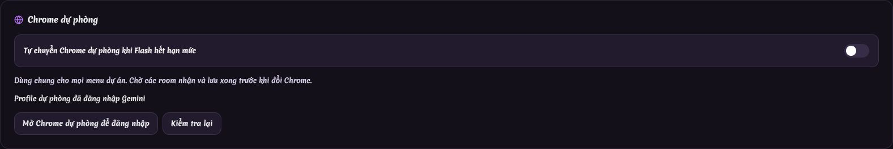

# Kiểm chứng Motion và Chrome dự phòng — 05/11/2026

> Bổ sung sau kiểm tra dự án thực: các test Retry ban đầu chưa phủ nhánh refusal và menu Gemini; prompt chung còn ràng buộc thiết bị phán quyết. Đã có patch và kiểm chứng bổ sung, gồm Gemini live, dữ liệu 27/36 và ảnh trước/sau. Xem [báo cáo dữ liệu thực trên Chrome](motion-real-data-chrome-report-2026-11-05.md) để biết kết quả và giới hạn hiện tại.

## Kết quả triển khai

| Hạng mục | Kết quả |
| --- | --- |
| Pool dựng cảnh | 5 room dựng cảnh + 2 room nội dung, tối đa 7 room vật lý Motion; giữ phụ thuộc cảnh mẫu, nhận diện và ngữ cảnh đã chốt |
| Phục hồi chat | Nút Thử lại đúng lượt hiện tại → 2 lần tại room đó → thay room một lần; các tầng gọi ngoài không nhân ngân sách |
| Yêu cầu chưa rõ kết quả | Ưu tiên đọc lại; không gửi trùng mù; chặn chuyển Chrome khi còn phản hồi chưa xác định |
| Quota Flash | Nhận diện dòng reset hạn mức trong đúng mục Flash yêu cầu, kể cả composer đang là Flash-Lite; không tự dùng Flash-Lite thay Flash |
| Chuyển Chrome | Ngừng gửi mới, chờ room đang chạy và ghi phản hồi thô, đóng Chrome cũ, mở profile dự phòng, khôi phục ngữ cảnh/model; single-flight, không chuyển qua lại vô hạn |
| Settings | Toggle dùng chung cho các menu dự án, lưu backend, chuẩn bị/kiểm tra profile, trạng thái đăng nhập; giữ mặc định tắt |
| Thể loại phán quyết | Bỏ ép cán cân, đạo cụ vật lý lặp lại, bảng tổng kết và thumbnail có đạo cụ; giữ câu hỏi, tiêu chí và lập luận |
| Log | Sequence, thời gian mili giây, severity và metadata hoạt động; thứ tự liên job, gộp canonical/tail, phân trang/reload, giữ nguyên nhân gốc và trạng thái kết thúc trước polling cũ |

Motion khôi phục lại editorial context và bible đã chốt khi đổi room/Chrome. Luồng âm nhạc khôi phục prompt đầy đủ cho phân tích phong cách và sáng tác khi room mới không còn lịch sử sửa nội dung.

## Chrome thật

- Dùng Chrome cài tại `C:\Program Files (x86)\Google\Chrome\Application\chrome.exe`, mở cửa sổ hiển thị.
- Đã mở 5 room Gemini thật; xác nhận Flash và mức suy nghĩ medium.
- Đã đóng Chrome chính, mở Chrome dự phòng và xác nhận lại Flash/medium bằng code sản phẩm.
- Hai tài khoản đang còn quota. Tín hiệu quota được tiêm tại ranh giới điều phối; payload chờ lưu đồng thời là dữ liệu kiểm thử. Không gọi đây là phát hiện quota cạn tự nhiên hay 5 phản hồi AI thật đồng thời thành công.
- Đã gửi yêu cầu Gemini thật sau bàn giao. UI trả lỗi dịch vụ, lần chạy chạm timeout/hủy; chưa nhận được kết quả thành công để xác nhận sinh nội dung xuyên suốt. Bản ghi máy đọc được: [chrome-backup-live-2026-11-05.json](chrome-backup-live-2026-11-05.json).
- Đã thao tác toggle trong ứng dụng thật ở `http://localhost:3002`, chuyển Settings ↔ Video Motion để kiểm tra lưu trạng thái rồi trả về tắt. Profile dự phòng đã đăng nhập.
- Đã kiểm tra card Settings trên Chrome hiển thị với controller sản phẩm: bật/tắt, reload, mobile, tiếng Anh và từ chối giá trị boolean sai.

Ảnh card trong ứng dụng thật, đã loại vùng API key:

## Kiểm tra đạt

- TypeScript `tsc --noEmit`, ESLint các source đã đổi, `git diff --check`.
- Vite production build và esbuild server bundle. Build có cảnh báo kích thước chunk; server CJS có cảnh báo `import.meta` từ source có sẵn.
- `verify-chrome-backup.ts`: quota đúng model/Flash-Lite, phạm vi nút Retry, bàn giao đồng thời, chờ ghi bền vững, lỗi lưu/đóng, phản hồi chưa rõ, hủy, cấu hình tắt, thiếu profile và backup hết quota.
- `verify-chrome-backup-settings.ts`: Settings trên Chrome thật hiển thị.
- `verify-chat-room-lifecycle.ts`: composer độc lập, giữ hội thoại, native Retry không gửi trùng, đúng 2 lần cùng room rồi thay room, khôi phục ngữ cảnh ở room mới.
- `verify-chat-submission-recovery.ts`, `verify-chat-upload-readiness.ts`, `verify-deepseek-chat.ts`, `verify-gemini-thinking.ts`.
- `verify-motion-room-budget.ts`: đỉnh 7 room thực, 5 dựng cảnh + 2 nội dung, nhiều phiên, fallback, CAPTCHA, lỗi đóng, hủy và warmup chậm.
- `verify-motion-scene-fallback.ts`, `verify-motion-scene-consistency.ts`, `verify-motion-ai-recovery.ts`.
- `verify-motion-log-events.ts`, `verify-motion-log-sections.ts`, `verify-motion-job-polling.ts`.
- `verify-motion-cancellation.ts`: giữ bản nháp/log sau dừng và reload, không tự chạy tiếp, hủy scene/voice, race bắt đầu/kết thúc và lỗi cancel.
- `verify-motion-persistence-integrity.ts`: 1.004 dòng log qua restart/phân trang, checkpoint lỗi, write failure, giọng và hủy job.
- `verify-motion-verdict-visuals.ts`, `verify-genre-editorial-contracts.ts`, `verify-motion-editorial-policy.ts`.
- `verify-music-planning-recovery.ts`: batch, nhiều room, checkpoint, hủy và giữ đúng nguyên nhân lỗi model.

Một số fixture cũ được sửa để khớp hợp đồng hiện tại: upload phải có marker đã sẵn sàng; job lịch sử phải trả đúng kind/status; lịch sử log nay có metadata trạng thái; artifact được phép replay phải được kiểm thử riêng với artifact chưa cho phép replay.

## Giới hạn còn lại

1. Không thể xác nhận Gemini thật thành công 100%: yêu cầu cuối vẫn lỗi dịch vụ/timeout. Không có video hoàn chỉnh được render trong đợt kiểm chứng này.
2. Ranh giới lưu trước khi đóng Chrome là **phản hồi thô đã flush**, chưa phải tất cả artifact/checkpoint nghiệp vụ đã xác thực. Backend vẫn tiếp tục xử lý kết quả nhận được sau khi browser đóng. Journal này chưa có cơ chế tự phát lại hoặc dọn theo hạn lưu.
3. Quota tự nhiên theo ảnh người dùng chưa xuất hiện trên các tài khoản thử; DOM theo ảnh đã được kiểm bằng fixture trên Chrome cài thật.
4. Không tuyên bố toàn bộ test repository đạt. `verify-motion-narrator-recovery.ts` dừng ở kỳ vọng 2 request nhưng nhận 1; chạy bundle với source HEAD cũng lỗi y hệt. `verify-motion-writing.ts` tham chiếu module/export đã không còn. `verify-motion-prompt-transport.ts` dùng scene fixture thiếu trường theo API hiện tại. Các test này có vấn đề có sẵn và chưa được sửa mở rộng trong đợt này.
5. Gate feature boundary có vi phạm có sẵn ở shared hook `useCaptchaAlert.ts` import feature Motion; audit runtime literal toàn repository cũng có tồn đọng. Không đưa chúng vào danh sách gate đã qua.

Mã đã được sửa và kiểm chứng trong phạm vi nêu trên. Nghiệm thu sinh nội dung xuyên suốt còn cần một lượt Gemini thật trả thành công.
